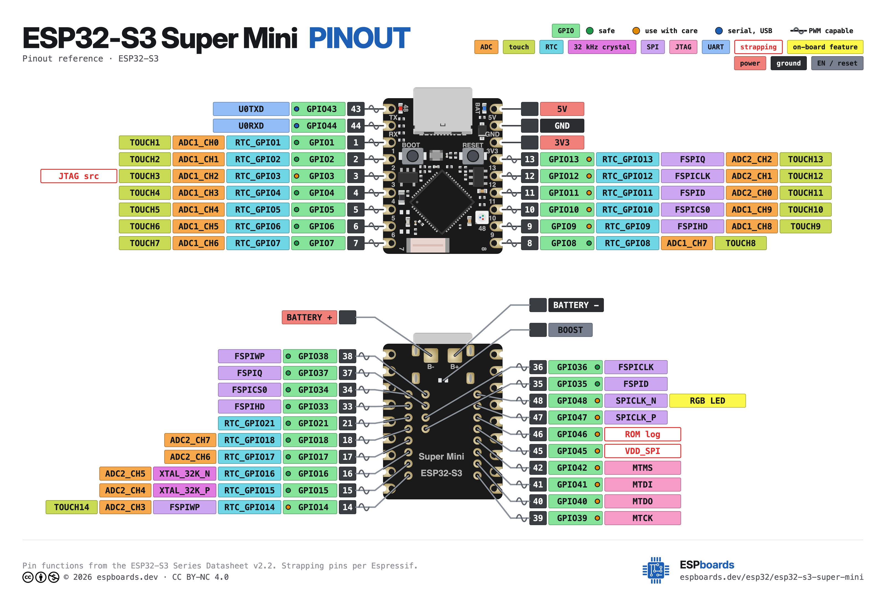

# Cobble 

Cobble is a development board designed to give easy access to sound, environment, and input while being easy to program with CircuitPython.

## Features

- ESP32-S3 Supermini module
- Vibration Sensor
- Light Sensor
- RGB LED
- Speaker
- Button
- Grove Connector
- Stemma Connector
- Battery Connector
- Power Switch 
- IO Header

## Board revisions

| Revision | Status | Notes |
| --- | --- | --- |
| **Rev 2** | **Current - first production run** | Fixed the Stemma connector, which was wired backwards on Rev 1 (the main change). Silkscreen updated, including a QR code. R3 (light sensor divider resistor) set to 10k - it worked at 1M as well, but 10k matches the other 10k resistor and reduces unique part count. Gerbers are in `Cobble-board/fab`. |
| **Rev 1** | Design Validation | 2 layer board test with all features implemented.  Fabricated 3 boards at OSHPark. Established the current pin map (below). |
| **Rev 0** | Concept Validation | Single-layer test board with seperate schematic and layout in `Cobble-board-test/` |

Pins did not change between Rev 1 and Rev 2, so the pin map below applies to both.

## ESP32S3-supermini Pinout


Link: https://www.espboards.dev/esp32/esp32-s3-super-mini/

## Pin mapping 

| ESP32-S3-super-mini Pin | Function | Notes | CircuitPython |
| --- | --- | --- | --- |
| GPIO7 | Light Sensor | Analog read with `analogio.AnalogIn`. GPIO7 is analog-capable, so it maps to A6. | `board.A6` |
| GPIO35 | PushButton | Configure as input with pull up. PushButton is active low. | `board.IO35` |
| GPIO9 | Vibration Sensor | Configure as input with pull up. Vibration is active low. | `board.IO9` |
| GPIO8 | Buzzer | **Never leave high!** Set as output low when not in use. Drive with PWM 50% duty cycle to create sound. | `board.IO8` |
| GPIO48 | NeoPixel | RGB status LED. | `board.IO48` |
| GPIO16 | SCL | I2C for the J3 Stemma and J4 Grove connectors. 4k7 pull-up pads on the board (R4-R7) are do-not-place, so pull-ups come from the attached device. | `board.IO16` |
| GPIO17 | SDA | I2C for the J3 Stemma and J4 Grove connectors. 4k7 pull-up pads on the board (R4-R7) are do-not-place, so pull-ups come from the attached device. | `board.IO17` |
| GPIO1, GPIO2, GPIO4, GPIO5, GPIO6, GPIO15 | Header GPIOs | General-purpose header pins aligned with power and ground pairs. | `board.IOx` |
| GPIO10, GPIO11, GPIO12, GPIO13 | Header GPIOs (SPI) | Header pins aligned for SPI (native SPI pins). | `board.IOx` |

Reference example code using the full Rev 1 pin map: `CircuitPython/Cobble-Rev1/test/code.py`.

## Design notes

Note about 5V Power:
- When USB is connected this will be 5V from VBUS
- When running from a battery this will be Vbatt-V_protection_diode
- Battery can only charge when USB is connected and power switch is 'ON'

## CircuitPython Notes

Testing completed with: 
- Version: 10.3.1
- Using the ESP32-S3-Zero build of CircuitPython.  It is a good standin for the super mini on our board: https://circuitpython.org/board/waveshare_esp32_s3_zero/
- the `boot_out.txt` file is an informational text file automatically generated on the root of the CIRCUITPY drive every time a CircuitPython board powers up or resets.  Contains:
  - CircuitPython Version
  - Build Date
  - Board Model
  - Board ID
  - UID
  - MAC

### Tips & tricks
- **Pin objects**: 
  - Digital pins are `board.IOx` (e.g. `board.IO35` for the pushbutton)
  - The analog light sensor is `board.A6` (GPIO7).
- **Analog input**: 
  - Use `analogio.AnalogIn(pin)`. There is no `board.ADC()`.
  - Read the value with `.value` (0–65535)
- **Digital input**: 
  - set direction with `digitalio.Direction.INPUT`
  - button (GPIO35) and vibration sensor (GPIO9) use `digitalio.Pull.UP` and read active low
- **Digital input Pull UP / DOWN**: 
  - set a pull up with `.pull = digitalio.Pull.UP`
  - set a pull down with `.pull = digitalio.Pull.DOWN`
- **I2C**: 
  - Use `busio.I2C(scl_pin, sda_pin)` (e.g. `busio.I2C(board.IO16, board.IO17)`)
  - The 4k7 pull-up pads (R4-R7) are do-not-place, so the bus may not initialize or get ACKs
    until an attached device brings its own pull-ups.  Wrap I2C calls and re-scan in a loop so
    a device plugged in mid-run is picked up without crashing.  You can install your own 4k7 resistors (0603 or leaded, not both) if desired.
  - `scan()` only works while the bus is held with `try_lock()`
  - GPIO16/17 are IOMUX-capable on the ESP32-S3, so `busio.I2C` is allowed on them.
  - The REPL console is on USB, so GPIO16/17 are free for I2C.
- **NeoPixel**: the constructor is `neopixel.NeoPixel(pin, n, brightness=...)` —
  the `pixel_bit_depth` keyword is not accepted on this build.

### Example Code Snippets
#### **I2C**: Configure I2C bus and scan for devices
``` python
import board
import busio

i2c = busio.I2C(board.IO16, board.IO17)  # SCL, SDA for J3/J4 connectors

def scan_i2c():
    """Scan the I2C bus and return list of connected device addresses."""
    devices = []
    if not i2c.try_lock():
        return devices
    try:
        for addr in range(0x08, 0x78):
            try:
                i2c.writeto(addr, b"")
                devices.append(addr)
            except OSError:
                pass
    finally:
        i2c.unlock()
    return devices
```

#### **Light Sensor**: Read the analog value (GPIO7 / A6)
``` python
import board
import analogio

light = analogio.AnalogIn(board.A6)
print(light.value)  # 0-65535
```

#### **PushButton**: Input with pull up, active low (GPIO35)
``` python
import board
import digitalio

button = digitalio.DigitalInOut(board.IO35)
button.direction = digitalio.Direction.INPUT
button.pull = digitalio.Pull.UP

pressed = not button.value  # True when the button is pressed
```

#### **Speaker**: Configure pin for PWM and play tone
``` python
import board
import pwmio
import time

piezo = pwmio.PWMOut(board.IO8, frequency=440, duty_cycle=0, variable_frequency=True)

# 8 notes of a C Major octave (C5 to C6) in Hertz
OCTAVE_NOTES = [
    523,  # C5
    587,  # D5
    659,  # E5
    698,  # F5
    784,  # G5
    880,  # A5
    988,  # B5
]

def startup_song():
    # Loop through each note in the octave scale
    for freq in OCTAVE_NOTES:
        piezo.frequency = freq
        piezo.duty_cycle = 32768  # Start tone (50% duty cycle)
        time.sleep(0.1)           # Play note for 0.1s
    
    # Mute tone and clean up hardware resource
    piezo.duty_cycle = 0
```

#### **RGB LED Neopixel**: Configure pin and show RGB colors
``` python
import board
import neopixel

# Initialize NeoPixel on the default board pin (or replace board.NEOPIXEL with board.IOx)
pixel = neopixel.NeoPixel(board.IO48, 1, brightness=0.2)

# Set color to Green (RGB: Red=0, Green=255, Blue=0)
pixel[0] = (0, 255, 0)

def wheel(pos):
    """Return an RGB tuple for a position 0-255 around the color wheel."""
    pos %= 256
    if pos < 85:
        return (255 - pos * 3, pos * 3, 0)
    elif pos < 170:
        pos -= 85
        return (0, 255 - pos * 3, pos * 3)
    else:
        pos -= 170
        return (pos * 3, 0, 255 - pos * 3)

# Rainbow fade state: hue position (0-255) and per-step increment
hue = 0
HUE_STEP = 2  # higher = faster cycle

def rainbow():
    """Advance the hue and set the pixel to the new rainbow color."""
    global hue
    hue = (hue + HUE_STEP) % 256
    pixel[0] = wheel(hue)
```

#### Included modules for CircuitPython 10.3.1:
_asyncio
_bleio
_bleio (native)
_eve
_pixelmap
adafruit_bus_device
adafruit_pixelbuf
aesio
alarm
analogbufio
analogio
array
atexit
audiobusio
audiocore
audioi2sin
audiomixer
audiomp3
binascii
bitbangio
bitmapfilter
bitmaptools
board
builtins
builtins.pow3
busdisplay
busio
busio.SPI
busio.UART
canio
codeop
collections
countio
digitalio
displayio
epaperdisplay
errno
espcamera
espidf
espnow
espulp
fontio
fourwire
framebufferio
frequencyio
getpass
gifio
hashlib
i2cdisplaybus
io
ipaddress
jpegio
json
keypad
keypad.KeyMatrix
keypad.Keys
keypad.ShiftRegisterKeys
keypad_demux
keypad_demux.DemuxKeyMatrix
locale
lvfontio
math
max3421e
mdns
memorymap
microcontroller
msgpack
neopixel_write
neopixel
nvm
onewireio
os
os.getenv
paralleldisplaybus
ps2io
pulseio
pwmio
qrio
rainbowio
random
re
rgbmatrix
rotaryio
rtc
sdcardio
sdioio
select
sharpdisplay
socketpool
socketpool.socketpool.AF_INET6
ssl
storage
struct
supervisor
supervisor.get_setting
synthio
sys
terminalio
tilepalettemapper
time
touchio
traceback
ulab
usb
usb_audio
usb_cdc
usb_hid
usb_midi
vectorio
warnings
watchdog
wifi
zlib
