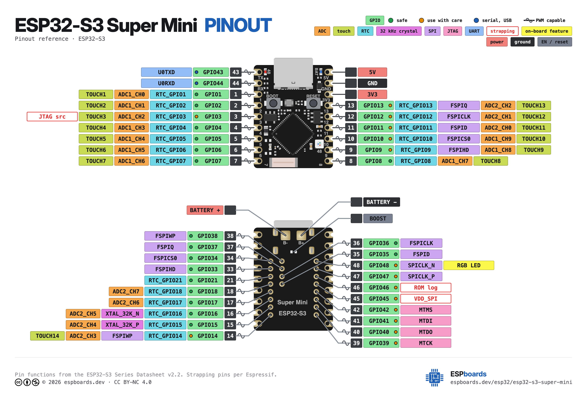

# Cobble Hardware Design

## ESP32S3-supermini Pinout

Link: https://www.espboards.dev/esp32/esp32-s3-super-mini/

## Cobble-board-test
the Cobble-board-test/ folder contains the single layer layout design used for the cobble smoke test board.  

